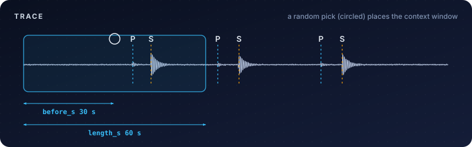
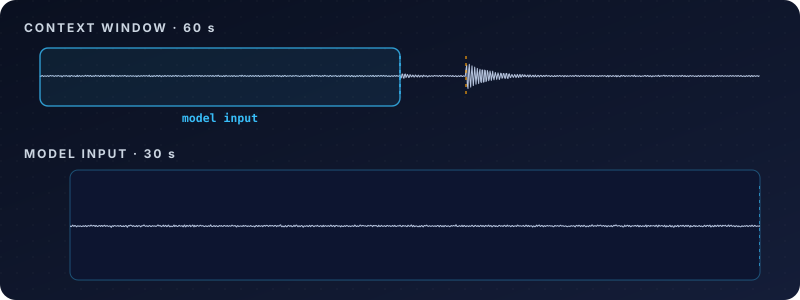
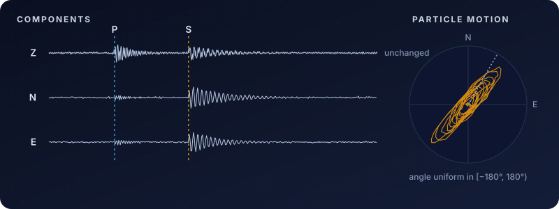
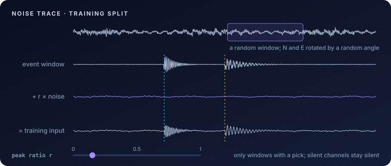
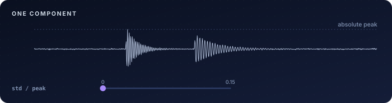

# Augmentations

Augmentations show the model a different version of every training trace in
every epoch: another window, another orientation of the horizontals, another
noise level, a missing component. The model then learns what a phase
arrival looks like, not where it sits in a window or how loud the background
is. Augmentations run in training only; validation and test windows are
fixed per trace, so their scores compare across epochs and runs.

## The pipeline

`augmentation.train` is a list of steps, applied in order to every training
example:

{ .sbt-figure }

- **Windows first.** Any `pick_window` steps, then exactly one
  `random_window`, which crops the model input. The perturbations follow.
  The config check refuses any other order.
- **Every random step has a `probability`**: the chance that it is applied
  to one example; otherwise the example passes unchanged. Each step draws on
  its own, so an example may get none, some or all of them.
- **Before the list**, every pipeline sets NaN samples (missing components,
  gaps) to zero, as `annotate` does, and collects the trace's arrivals
  ([Labels](labels.md)).
- **After the list**, each channel is normalized (`augmentation.normalization`,
  default `std`) and the [labels](labels.md) are written. The steps therefore
  see raw waveforms, and an arrival a step removes gets no label.
- **Random draws** come from generators seeded per DataLoader worker;
  `training.seed` fixes them.

The defaults follow SeisBench's pick-benchmark PhaseNet recipe plus the
perturbations that held up in our experiments ([Findings](../findings/index.md)):

```json
{
  "augmentation": {
    "train": [
      {"type": "pick_window", "probability": 0.667},
      {"type": "random_window"},
      {"type": "rotate_horizontal", "probability": 0.5},
      {"type": "real_noise", "probability": 0.5},
      {"type": "channel_dropout", "probability": 0.2}
    ]
  }
}
```

`add_gap` and `gaussian_noise` are available but not in the defaults. A list
in a config replaces the default list as a whole.

The perturbations are reviewed re-implementations of the
`seisbench.generate` ones: each class in `data/perturbations.py` documents
where it deviates and why. The deviations that change results are noted
below.

## Windows

### pick_window

Cuts a context window around a pick: `length_s` long (default 60 s),
starting `before_s` (default 30 s) before a pick of the trace's own event,
chosen at random among its P and S picks.

{ .sbt-figure }

With `probability` (default 2/3) the example gets a context window;
otherwise `random_window` crops from the whole trace, which may then hold no
pick at all. The model needs those pick-free windows to learn what noise
looks like. `length_s` must exceed the model input, about twice the input is
usual: otherwise `random_window` could not move the pick, and it would
always sit `before_s` into the input.

### random_window

Crops a window of the model input length (PhaseNet: 3001 samples) at a
random position: from the context window if `pick_window` cut one, otherwise
from the whole trace. A trace shorter than the input is padded with zeros.
Always applied; there is exactly one per pipeline.

{ .sbt-figure }

Together, the two windows put the pick anywhere in the input, and the
[labels follow it](labels.md#labels-follow-the-window).

## Perturbations

### rotate_horizontal

Rotates the N and E components by an angle drawn uniformly from
[-180°, 180°). Z is unchanged. Earthquakes arrive from every direction; a
rotation shows the model the same event from another backazimuth.

{ .sbt-figure }

N and E are found by the run's `data.component_order`. SeisBench reads the
order on disk from the metadata instead, which rotates N with Z when the
data are loaded in another order than they are stored.

### real_noise

Adds a random window of a recorded noise trace from the **training split**
(`query`, default `trace_category == "noise"`), so the model learns to pick
at low signal-to-noise ratios in the noise of real stations. The noise
window's horizontals are rotated by a random angle, so one recording gives
many horizontal noise fields; the window is demeaned and scaled by `level`:

| `level` | Noise amplitude |
| --- | --- |
| `{"type": "peak", "ratio": [0, 1]}` (default) | Noise peak = `ratio` × the window's peak, `ratio` uniform (SeisBench's `scaling_type="peak"`) |
| `{"type": "std", "ratio": [0.1, 2]}` | Noise std = `ratio` × the window's std, `ratio` log-uniform (the dlf-catalog reference recipe) |

{ .sbt-figure }

- Only windows with an arrival get noise: noise added to noise teaches
  nothing the noise traces do not. `probability` is therefore the chance
  per window with a pick.
- A component that is all zeros (missing, or dropped) gets no noise: it
  stays missing.
- Dev and test noise traces are never used here. The [noisy
  validation](evaluation.md#metric-names) adds the dev split's own noise to
  the dev windows instead.
- A dataset without noise traces (BohemiaSaxony, ETHZ) runs without the step
  and logs a warning.

### channel_dropout

Sets one or two of the three components to zero, never all of them. The
model learns to pick on stations with a missing or dead component, which
reach it as zeros at inference too. The labels stay: the arrivals are still
in the other components.

{ .sbt-figure }

SeisBench's version drops 0 to 2 of 3 channels, so a third of its dropouts
change nothing. Nothing is rescaled: normalization is per channel. In the
default list it comes after `real_noise`, so a dropped component stays
silent.

### add_gap

Sets all components to zero over a stretch of `length_s` (default 0.5 to
5 s; EQTransformer used gaps of up to 5 s), as in a data gap. An arrival inside the gap is
removed and gets no label.

{ .sbt-figure }

SeisBench draws the gap up to the end of the window, so its gaps range from
empty to almost the whole window, and it keeps the picks inside a gap, which
labels arrivals on zeros.

### gaussian_noise

Adds white noise with a standard deviation of `scale` × the absolute peak
of the window, `scale` drawn uniformly from (0, 0.15) by default.

{ .sbt-figure }

`real_noise` is the more realistic choice when the dataset has noise
traces. SeisBench scales by the signed maximum, which is the DC offset for
raw counts; here the peak is that of the demeaned waveform.
