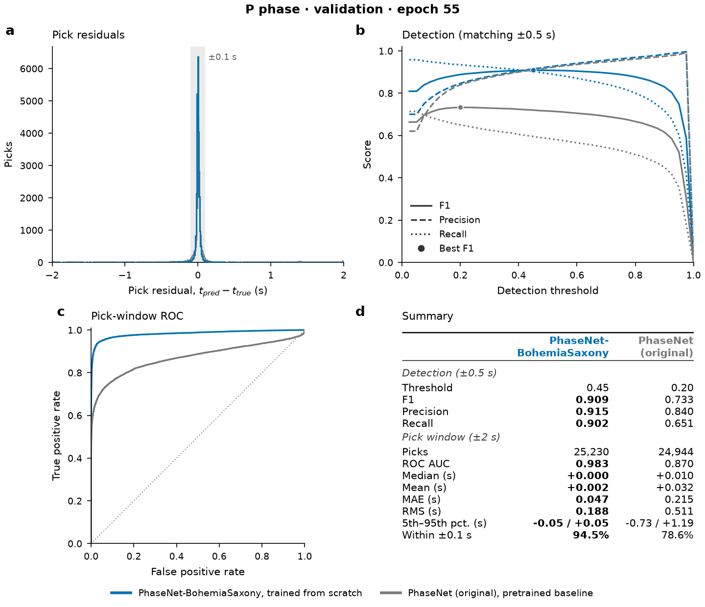

# Evaluation

## Two metric families

Validation runs on the dataset's `dev` split, testing on its `test` split.
Every validation epoch scores each phase two ways:

| Family | Question | How |
| --- | --- | --- |
| `pick_<phase>` | How accurate is the pick near a known arrival? | The highest probability within `pick_window_s` of each true pick is the predicted pick; residuals in seconds, ROC against the maximum probability of pick-free traces |
| `det_<phase>` | How well does the model detect arrivals on its own? | Peaks above `min_peak_height` anywhere in the window, matched one-to-one to true picks within `tolerance_s`; unmatched peaks are false picks |

Each family reports the F1-optimal `threshold`, `precision`, `recall`, `f1`,
`auc`, average precision (`ap`), the residual statistics of all true picks
(`mean_s`, `median_s`, `mae_s`, `rms_s`, `p05_s`, `p95_s`, `within_<t>s`)
and of the picks found at the threshold (`mae_s_at_threshold`, ...).
`det/f1_mean` is the mean of the P and S detection F1 and the default
selection metric.

What counts as a true pick follows `augmentation.label_events` and
`missing_picks` ([Labels](labels.md)): by default every catalogued arrival in
the window, and a phase that may arrive unread is not counted against the
model.

## Metric names

| Prefix | Meaning |
| --- | --- |
| (none) | The trained model on the validation windows, every epoch |
| `noisy/` | The same windows with real noise from the dev split added |
| `baseline/` | The pretrained baseline (`evaluation.baseline`), logged once |
| `test_` | The test evaluation (`evaluation.test_at_end` or `evaluate`) |

For example `det_P/f1`, `noisy/det/f1_mean`, `baseline/pick_S/mae_s`,
`test_det_P/tol0.2s/f1`.

The baseline has fixed weights and the validation windows are fixed, so it
is evaluated in the first epoch only, fed in its own component order. Set
`"baseline": null` to skip it, e.g. when its pretrained weights cannot be
downloaded.

The noisy validation adds real noise from the dev split's own noise traces
(which training never sees) at 0.5-1 times the window peak, seeded per
trace. It measures robustness; model selection stays on the clean windows.

## Figures

Every `plot_every_n_epochs` epochs the run logs one figure per phase, the
trained model (blue) next to the baseline (grey). All epochs go into one HTML
page per phase with an epoch slider (`evaluation/validation_P.html` in the
MLflow run), and the best epoch's figures go with the exported model.



*P phase, best epoch of PhaseNet trained from scratch on BohemiaSaxony with
`label_events: all_events` (blue), against the pretrained `original`
PhaseNet (grey), on the same validation windows. The
[S-phase figure](../assets/images/validation-S.png) has the same layout.*

| Panel | Shows | Read it as |
| --- | --- | --- |
| **a** Pick residuals | Predicted minus true pick time within ±`pick_window_s`, on the sample grid; shaded ±`min(test_tolerances_s)` | A narrow peak at 0: precise picks. Here 94.5 % within 0.1 s |
| **b** Detection | F1, precision and recall of the detection metrics against the threshold; the dot is the F1-optimal threshold | A broad F1 plateau: a threshold that is easy to choose and robust in deployment |
| **c** Pick-window ROC | True picks against the pick-free traces' maximum probability | Close to the top-left corner: picks stand out from noise |
| **d** Summary | Detection at the optimal threshold, pick-window statistics; the better value per row in bold | The numbers behind a-c |

## Test and cross-dataset evaluation

```bash
seisbench-trainer evaluate --model <run_id>                       # its test split
seisbench-trainer evaluate --model models:/<name>@champion --dataset ETHZ
seisbench-trainer evaluate --model PhaseNet:original --dataset BohemiaSaxony
seisbench-trainer evaluate --model <run_id> --split dev --json
```

Detection thresholds are selected on the dev split at `tolerance_s` and
applied unchanged to the evaluated split at each of `test_tolerances_s`. The
test split is never used for model selection, thresholds or HPO. Results are
logged as an MLflow run linked to the model and the dataset, with a summary
table (`evaluation/test_summary.csv`).

`--config` gives the data, augmentation and evaluation settings; by default
`evaluate` uses the model's training config. A dataset is loaded in the
model's own component order, and the model must run at the data's sampling
rate.
