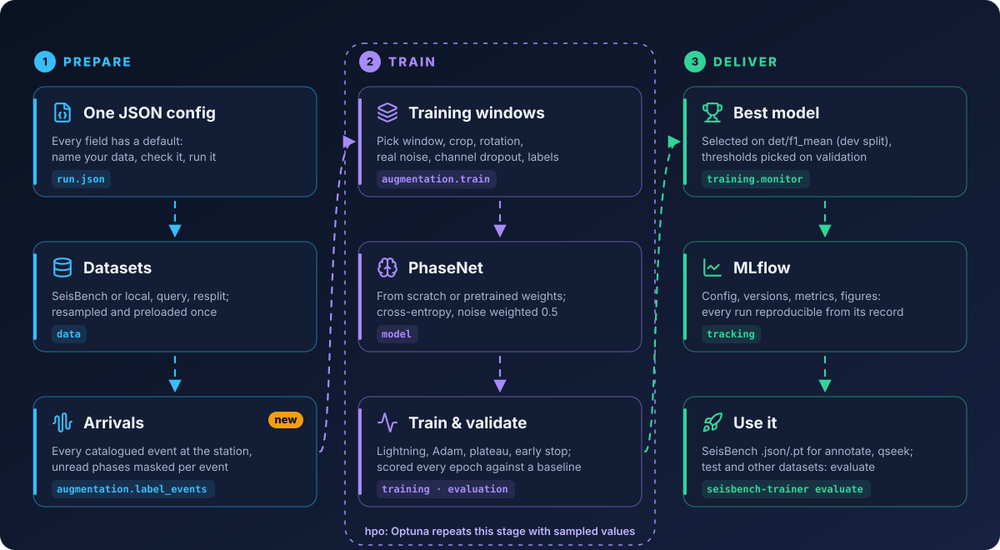

# Guide

A run goes through three stages. Each building block is one section of the
run config, so the picture is also a map of the config file.

{ .sbt-figure }

-   :lucide-sliders-horizontal:{ .lg .middle } __[Configuration](configuration.md)__

    ---

    One JSON file per run, every field with a default; choices tagged by
    `type`; checking a config before it runs.

-   :lucide-database:{ .lg .middle } __[Data](data.md)__

    ---

    Dataset sources, queries and splits, component order, sampling rate and
    the training windows.

-   :lucide-tag:{ .lg .middle } __[Labels](labels.md)__

    ---

    Every event in a window labelled, the label curve, and phases that may
    arrive unread.

-   :lucide-activity:{ .lg .middle } __[Training](training.md)__

    ---

    Starting weights, loss, run length, learning rate and model selection.

-   :lucide-chart-line:{ .lg .middle } __[Evaluation](evaluation.md)__

    ---

    Pick and detection metrics every epoch, the baseline, the figures, and
    test evaluation.

-   :lucide-package:{ .lg .middle } __[Tracking and models](tracking.md)__

    ---

    What MLflow records, the exported SeisBench model, and using it in qseek.

-   :lucide-sparkles:{ .lg .middle } __[Hyperparameter search](hpo.md)__

    ---

    Optuna studies over any config field, shared by many workers.

-   :lucide-server:{ .lg .middle } __[Slurm cluster](cluster.md)__

    ---

    Batch scripts, a folder store for MLflow, and notes from running at
    scale.

-   :lucide-bot:{ .lg .middle } __[Scripts and agents](automation.md)__

    ---

    JSON results, exit codes and config checks for automation.

