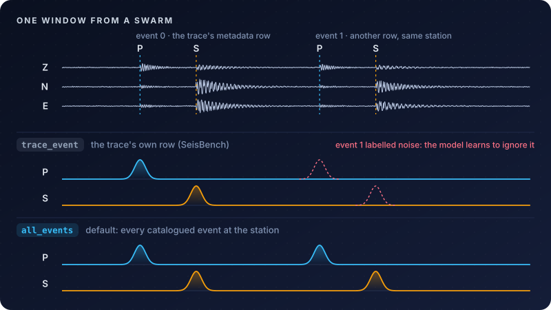
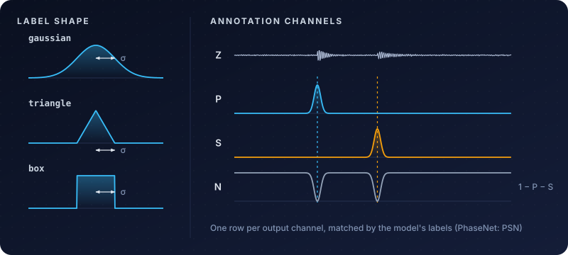
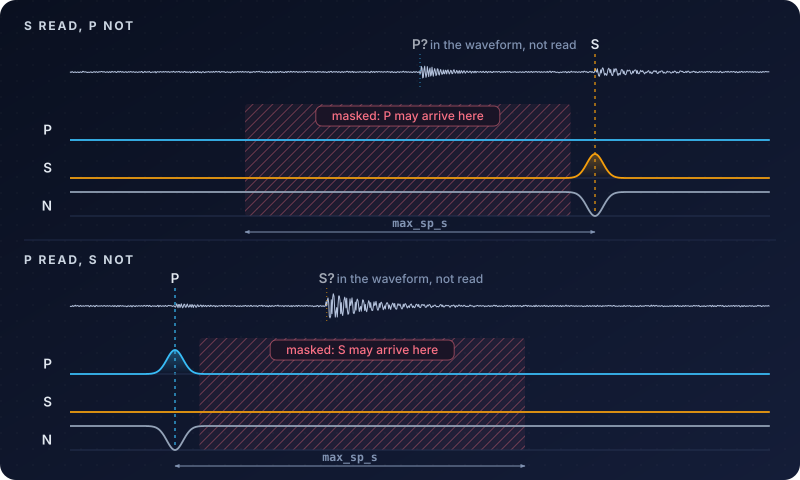

# Labels

PhaseNet learns from a target curve per output channel: P, S and noise. This
page explains which arrivals get a curve, how the curve looks, how the labels
follow the training window, and where the loss and the metrics ignore a phase
that may be there but was not read.

## Other events in the window are labelled, not taught as noise

{ .sbt-figure }

A SeisBench metadata row describes one trace and one event: its pick columns
(`trace_P_arrival_sample`, `trace_Sg_arrival_sample`, ...) hold that event's
arrivals only. When events follow each other closely, as in a swarm, a
training window cut around one event often contains arrivals of the next.
Read from the row alone, those arrivals are labelled noise, the model is
trained to ignore them, and the metrics count its correct detections of them
as false picks. On BohemiaSaxony 25 % of the event traces have another
event's pick within 30 s of their own.

With `augmentation.label_events: "all_events"` (the default) the trainer
finds these arrivals. When the datasets load, it builds a catalogue of every
pick by station and absolute time (`data.arrivals.StationPicks`), from the
datasets before their queries and filters: an event left out of the training
data still arrived in the waveforms. For every trace it then adds the picks
of every other event recorded at the same station inside the trace.

The first step of every pipeline (`data.arrivals.Arrivals`) writes the
trace's arrivals into its metadata, per phase: positions in samples
(`arrivals_P_sample`) and event numbers (`arrivals_P_event`, 0 for the
trace's own event). The window steps shift these arrays like any pick
column; the labels, the unread mask, the pick metrics, `add_gap` and
`real_noise` read only them.

`all_events` needs `trace_start_time`, `trace_sampling_rate_hz` and the
station codes in the metadata, which SeisBench datasets have. For a dataset
without them, set `"label_events": "trace_event"`: the trace's own row only,
SeisBench's behaviour.

!!! note "Compare runs under one ground truth"
    `label_events` also defines what the validation and test metrics count
    as a true pick. Scores of runs with different settings, or of runs
    from before this option, are only comparable after re-scoring them with
    `seisbench-trainer evaluate`, which uses the setting of the config it is
    given.

## The annotation: one curve per output channel

The labels are the target of the model's output, its annotation: one row per
output channel. PhaseNet's channels are `PSN`; each row is matched to its
channel by the model's label name, never by position.

{ .sbt-figure }

`data.labels.PickLabeller` writes one curve per arrival, inside the window or
not (a pick just outside still leaves its tail), and takes the maximum per
phase. Where the P and S rows sum to more than 1 they are scaled to 1; the
noise row is 1 minus their sum. The curve and the arithmetic are SeisBench's
`ProbabilisticLabeller`, which a test checks bit for bit, without its other
modes (polarity labels, multi-window batches, column detection).

| Setting | Meaning |
| --- | --- |
| `label_shape` | `gaussian` (std `label_sigma_s`), `triangle` or `box` (half-width `label_sigma_s`) |
| `label_sigma_s` | Width in seconds; 0.1 s suits impulsive tectonic onsets, 0.2-0.4 s emergent ones such as deep low-frequency events |

The width belongs in seconds, not samples: at 50 Hz and 100 Hz the same width
in seconds gives the same F1, the same width in samples does not.

## Labels follow the window

Labels are not stored with the data. Like SeisBench's
`ProbabilisticLabeller`, `PickLabeller` writes them for every training
example from scratch, after the window is cut and the perturbations are
applied, from the positions of the arrivals in that window. When
`random_window` crops the trace somewhere else, the arrivals shift with the
crop and their curves with them: the model sees each pick at a new position
in every epoch, and learns to pick wherever it is in the input.

{ .sbt-figure }

- An arrival just outside the window still adds the part of its curve that
  reaches into it.
- An arrival that a perturbation removes (an [`add_gap`](augmentations.md#add_gap)
  over the pick) gets no curve.
- Validation and test windows are labelled the same way, but placed at a
  fixed offset per trace, so they are the same in every epoch.

At inference SeisBench's `annotate` slides the model over a continuous stream
in overlapping windows and combines their outputs into one annotation per
channel, the counterpart of the moving training window.

## Missing phase labels

!!! info "A missing pick is not a missing arrival"
    Many catalogues read only one phase at some stations: on
    deeplowfrequency, a local dataset of deep low-frequency volcanic events,
    24 % of the event traces have an S pick but no P. The arrival may well
    be in the waveform; the analyst may just not have read it. Labelled as
    noise, it would teach the model to ignore real arrivals, and the metrics
    would count picking it as a false pick.

With `missing_picks: "unread"` (the default), for every event of the window
that has one phase but not the other, the stretch where the other phase can
arrive is masked:

{ .sbt-figure }

- S but no P: the P row is masked from `max_sp_s` before the S up to 3 label
  sigmas before it.
- P but no S: the S row is masked from 3 label sigmas after the P up to
  `max_sp_s` after it.

The loss ignores every output channel at masked samples; the metrics ignore
that phase's peaks there. `max_sp_s` (default 15 s, the longest S-P time of
local and volcanic seismicity; raise it for regional data) keeps one event's
mask from hiding the other events' arrivals. `null` masks up to the window
edge.

With `missing_picks: "absent"`, a missing pick means no arrival: the label is
noise there and every peak counts as a false pick (SeisBench's pick-benchmark).

## Effect

Training with `all_events` and `max_sp_s` 15 against the trace's own row,
two seeds each, scored on all arrivals ([details](../experiments.md)):

| | `trace_event` | `all_events` |
| --- | --- | --- |
| BohemiaSaxony test `det/f1_mean` | 0.888 | **0.900** |
| BohemiaSaxony pick MAE P / S | 19.0 / 29.8 ms | **18.2 / 28.6 ms** |
| deeplowfrequency test `det/f1_mean` (sigma 0.3 s) | 0.825 | **0.831** |
| qseek, West Bohemia swarm, located events | 4,215-4,479 | **5,119-5,201** |
| qseek, semblance on common events | 0.81-0.82 | **0.89-0.93** |

`max_sp_s` alone changes nothing; the gain comes from labelling the other
events.
