<div class="sbt-hero" markdown>

<div class="sbt-hero__text" markdown>

<p class="sbt-eyebrow">seisbench-trainer</p>

# Train phase pickers that see every event { .sbt-title }

Train, evaluate and tune [SeisBench](https://github.com/seisbench/seisbench)
pickers from one JSON file. The defaults come from real experiments, every
event in a window is labelled, and every run is tracked in
[MLflow](https://mlflow.org), ready for SeisBench and qseek.

[:lucide-rocket: Quickstart](quickstart.md){ .md-button .md-button--primary }
[:lucide-book-open: Guide](guide/index.md){ .md-button }

</div>

{ .sbt-hero__image }

</div>

<div class="sbt-stats" markdown>

<div><strong>+0.012</strong><span>F1 on a swarm dataset, from labelling every event</span></div>
<div><strong>+17 %</strong><span>located events in a qseek swarm benchmark</span></div>
<div><strong>1 file</strong><span>describes a run; every field has a default</span></div>
<div><strong>Every run</strong><span>reproducible from its MLflow record: config, versions, metrics</span></div>

</div>

## Why seisbench-trainer

<div class="grid cards" markdown>

-   :lucide-file-json:{ .lg .middle } __One file, good defaults__

    ---

    A run is one JSON file. Name your data; every other setting has a
    default that won an experiment, and `seisbench-trainer config` checks a
    file before anything runs.

    [:octicons-arrow-right-24: Configuration](guide/configuration.md)

-   :lucide-audio-waveform:{ .lg .middle } __Every event labelled__

    ---

    In swarms, other events' arrivals fall into a training window. They are
    found by station and time and labelled, not taught as noise.

    [:octicons-arrow-right-24: Labels](guide/labels.md)

-   :lucide-chart-line:{ .lg .middle } __Measured every epoch__

    ---

    Pick accuracy and detection scores against a pretrained baseline, on
    clean and noise-added windows; the test split stays untouched.

    [:octicons-arrow-right-24: Evaluation](guide/evaluation.md)

-   :lucide-rocket:{ .lg .middle } __Ready to use__

    ---

    The best model is a SeisBench `.json`/`.pt` pair with its thresholds:
    `PhaseNet.load()`, `annotate`, qseek.

    [:octicons-arrow-right-24: Tracking and models](guide/tracking.md)

-   :lucide-server:{ .lg .middle } __Laptop to cluster__

    ---

    The same config trains on a CPU in a minute or on a GPU with Slurm;
    Optuna studies share many workers.

    [:octicons-arrow-right-24: Slurm cluster](guide/cluster.md)

-   :lucide-bot:{ .lg .middle } __Made for automation__

    ---

    Results on stdout, logs on stderr, `--json` everywhere, exit code 2 for
    a bad config: scripts and coding agents drive it safely.

    [:octicons-arrow-right-24: Scripts and agents](guide/automation.md)

</div>

## How it works

Three stages, each block one section of the config:

{ .sbt-figure }

## What you get

Every run logs figures like this one per phase and epoch: pick residuals,
detection scores against the threshold, ROC, and a summary next to the
baseline. Here PhaseNet trained on BohemiaSaxony picks 94.5 % of the P
arrivals within 0.1 s, the pretrained model 78.6 %.

{ .sbt-figure .sbt-figure--light }

## Try it

```bash
uv sync
uv run seisbench-trainer train configs/synthetic-smoke.json   # a minute on a CPU, no download
uv run mlflow ui
```

[:lucide-rocket: Start with the quickstart](quickstart.md){ .md-button .md-button--primary }
[:lucide-lightbulb: See the findings](findings/index.md){ .md-button }
