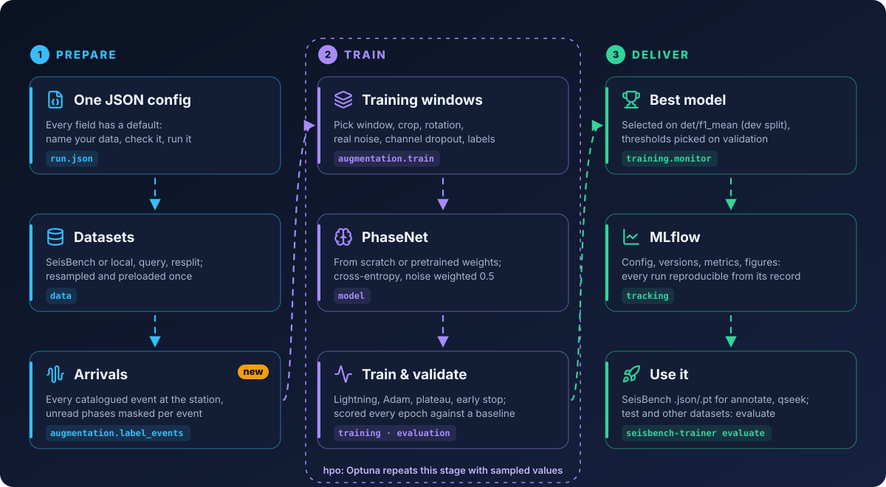

<div class="sbt-hero" markdown>

<div class="sbt-hero__text" markdown>

<p class="sbt-eyebrow">seisbench-trainer</p>

# Train SeisBench pickers from one JSON file { .sbt-title }

Fine-tune or train phase pickers on any
[SeisBench](https://github.com/seisbench/seisbench) or local dataset, or
several at once, on a laptop or a GPU cluster. Good defaults, checked
configs, every run tracked in [MLflow](https://mlflow.org) and exported as
a ready-to-use SeisBench model.

[:lucide-rocket: Quickstart](quickstart.md){ .md-button .md-button--primary }
[:lucide-book-open: Guide](guide/index.md){ .md-button }

<p class="sbt-note">PhaseNet today; other pickers plug in as new model types.</p>

</div>

{ .sbt-hero__image }

</div>

<div class="sbt-stats" markdown>

<div><strong>1 file</strong><span>describes a run; every field has a default</span></div>
<div><strong>4 commands</strong><span>config, train, evaluate, hpo</span></div>
<div><strong>Any dataset</strong><span>SeisBench, local, or several at once</span></div>
<div><strong>+17 %</strong><span>located events in a swarm benchmark with the default labels</span></div>

</div>

## Why seisbench-trainer

<div class="grid cards" markdown>

-   :lucide-database:{ .lg .middle } __Any dataset, any start__

    ---

    Any `seisbench.data` dataset or your own SeisBench-format folder, alone
    or combined, queried and resplit; from scratch or from pretrained
    weights.

    [:octicons-arrow-right-24: Data](guide/data.md)

-   :lucide-file-json:{ .lg .middle } __One file, good defaults__

    ---

    Name your data; every other setting has a default that won an
    experiment. `seisbench-trainer config` checks a file before anything
    runs.

    [:octicons-arrow-right-24: Configuration](guide/configuration.md)

-   :lucide-chart-line:{ .lg .middle } __Measured every epoch__

    ---

    Pick accuracy and detection scores against a pretrained baseline, on
    clean and noise-added windows; the test split stays untouched.

    [:octicons-arrow-right-24: Evaluation](guide/evaluation.md)

-   :lucide-audio-waveform:{ .lg .middle } __Every event labelled__

    ---

    When events follow closely, other events' arrivals fall into a training
    window. They are found by station and time and labelled, not taught as
    noise.

    [:octicons-arrow-right-24: Labels](guide/labels.md)

-   :lucide-package:{ .lg .middle } __Ready to use__

    ---

    The best model is a SeisBench `.json`/`.pt` pair with its thresholds:
    `PhaseNet.load()`, `annotate`, `classify`, and tools built on them.

    [:octicons-arrow-right-24: Tracking and models](guide/tracking.md)

-   :lucide-bot:{ .lg .middle } __Laptop to cluster, scripted__

    ---

    The same config runs on a CPU or as a Slurm job; Optuna studies share
    many workers. `--json` results and exit codes let scripts and agents
    drive it.

    [:octicons-arrow-right-24: Scripts and agents](guide/automation.md)

</div>

## How it works

Three stages, each building block one section of the config:

{ .sbt-figure .sbt-wide }

## What you get

Every run logs a figure like this per phase and epoch: pick residuals,
detection scores against the threshold, ROC, and a summary next to the
pretrained baseline. Here PhaseNet trained on BohemiaSaxony picks 94.5 % of
the P arrivals within 0.1 s, the pretrained model 78.6 %.

{ .sbt-figure .sbt-figure--light }

## Try it

```bash
git clone https://github.com/miili/seisbench-trainer && cd seisbench-trainer
uv sync
uv run seisbench-trainer train configs/synthetic-smoke.json   # about a minute on a CPU
uv run mlflow ui
```

[:lucide-rocket: Start with the quickstart](quickstart.md){ .md-button .md-button--primary }
[:lucide-lightbulb: See the findings](findings/index.md){ .md-button }
