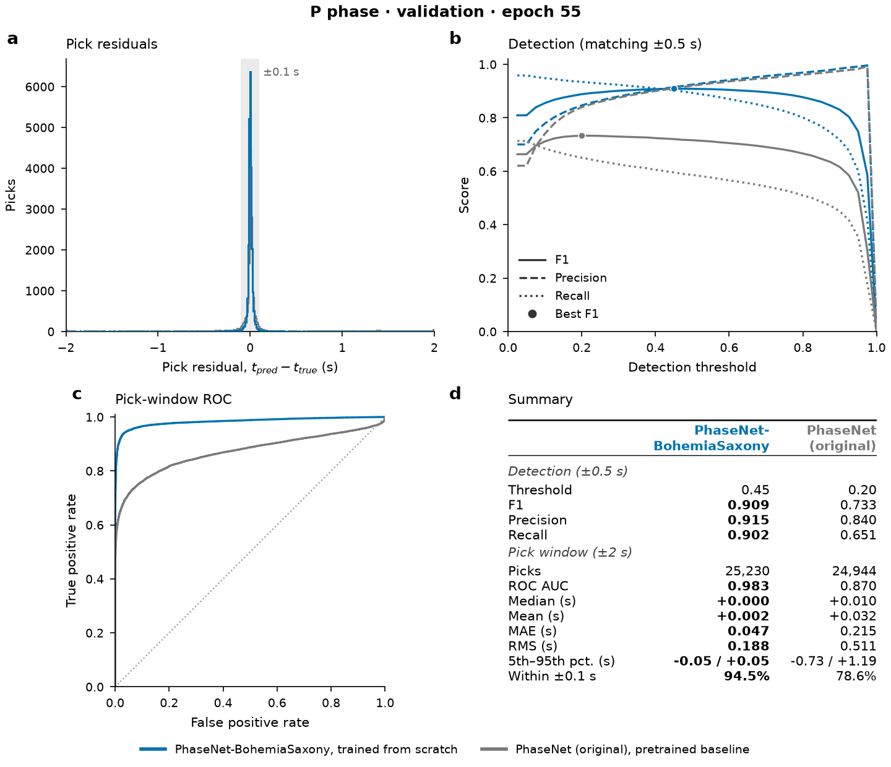

<div class="sbt-hero" markdown>

<div class="sbt-hero__text" markdown>

<p class="sbt-eyebrow">seisbench-trainer</p>

# Train SeisBench pickers from one JSON file { .sbt-title }

Fine-tune or train phase pickers on any
[SeisBench](https://github.com/seisbench/seisbench) or local dataset, or
several at once, on a laptop or a GPU cluster. Good defaults, checked
configs, every run tracked in [MLflow](https://mlflow.org) and exported as
a ready-to-use SeisBench model.

[:lucide-rocket: Quickstart](quickstart.md){ .md-button .md-button--primary }
[:lucide-book-open: Guide](guide/index.md){ .md-button }

<p class="sbt-note">PhaseNet today; other pickers plug in as new model types.</p>

</div>

{ .sbt-hero__image }

</div>

<div class="sbt-stats" markdown>

<div><strong>1 file</strong><span>describes a run; every field has a default</span></div>
<div><strong>4 commands</strong><span>config, train, evaluate, hpo</span></div>
<div><strong>Any dataset</strong><span>SeisBench, local, or several at once</span></div>
<div><strong>+17 %</strong><span>located events in a swarm benchmark with the default labels</span></div>

</div>

## Why seisbench-trainer

<div class="grid cards sbt-cards" markdown>

-   :lucide-audio-waveform:{ .lg .middle } __Every event in the window labelled__

    ---

    In a swarm, a window cut around one event often holds the next. Read
    from its metadata row, those arrivals are taught as noise. The trainer
    finds every catalogued pick by station and time and labels it.

    **+17 %** located events in a qseek swarm benchmark, **+0.012** test F1
    { .sbt-proof }

    [:octicons-arrow-right-24: Labels](guide/labels.md)

-   :lucide-flask-conical:{ .lg .middle } __Defaults that won experiments__

    ---

    Loss weights, learning rate, run length, augmentation and label width
    were settled by experiments on tectonic swarms and deep
    low-frequency events. A config names only what differs.

    **`{}`** is a complete config: PhaseNet from scratch on ETHZ
    { .sbt-proof }

    [:octicons-arrow-right-24: Findings](findings/index.md)

-   :lucide-chart-line:{ .lg .middle } __Scored against the pretrained model__

    ---

    Every epoch: pick residuals in seconds and detection F1 per phase, on
    clean windows and with real noise added, next to the pretrained
    baseline. Thresholds come from the dev split; test is scored once.

    **0.70 → 0.86** validation detection F1 on BohemiaSaxony, pretrained → trained
    { .sbt-proof }

    [:octicons-arrow-right-24: Evaluation](guide/evaluation.md)

-   :lucide-database:{ .lg .middle } __Any dataset, checked against the model__

    ---

    SeisBench datasets by name, your own folders, or several in one run;
    queried, resplit with events kept together. Component order and
    sampling rate must match the model: a mismatch is an error, not a
    silent channel swap.

    ```json
    "datasets": [
      {"type": "seisbench", "name": "ETHZ"},
      {"type": "local", "path": "~/data/mine"}
    ]
    ```

    [:octicons-arrow-right-24: Data](guide/data.md)

-   :lucide-package:{ .lg .middle } __A SeisBench model at the end__

    ---

    The best epoch is exported as a `.json`/`.pt` pair that carries its
    component order, sampling rate and validation thresholds. Load it in
    SeisBench, or hand it to qseek.

    ```python
    model = sbm.PhaseNet.load(path)
    picks = model.classify(stream).picks
    ```

    [:octicons-arrow-right-24: Tracking and models](guide/tracking.md)

-   :lucide-server:{ .lg .middle } __Laptop to Slurm, scripted__

    ---

    The same file trains on a CPU or as a Slurm job, with MLflow in a shared
    folder and no server. Optuna workers share one study. `--json` and exit
    codes let scripts and agents drive it.

    ```bash
    sbatch --array=0-3 \
      slurm/hpo_worker.sbatch run.json
    ```

    [:octicons-arrow-right-24: Slurm cluster](guide/cluster.md)

</div>

## How it works

Six building blocks in three stages, each labelled with its config section:

{ .sbt-figure .sbt-wide }

## What you get

Every run logs a figure like this per phase and epoch: pick residuals,
detection scores against the threshold, ROC, and a summary next to the
pretrained baseline. Here PhaseNet trained on BohemiaSaxony picks 94.5 % of
the P arrivals within 0.1 s, the pretrained model 78.6 %.

{ .sbt-figure .sbt-figure--light }

## Try it

```bash
git clone https://github.com/miili/seisbench-trainer && cd seisbench-trainer
uv sync
uv run seisbench-trainer train configs/synthetic-smoke.json   # about a minute on a CPU
uv run mlflow ui
```

[:lucide-rocket: Start with the quickstart](quickstart.md){ .md-button .md-button--primary }
[:lucide-lightbulb: See the findings](findings/index.md){ .md-button }
